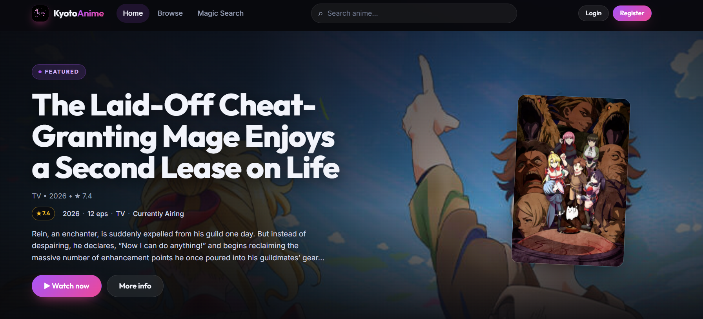
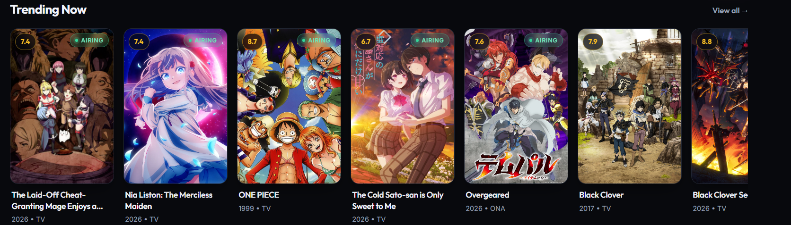
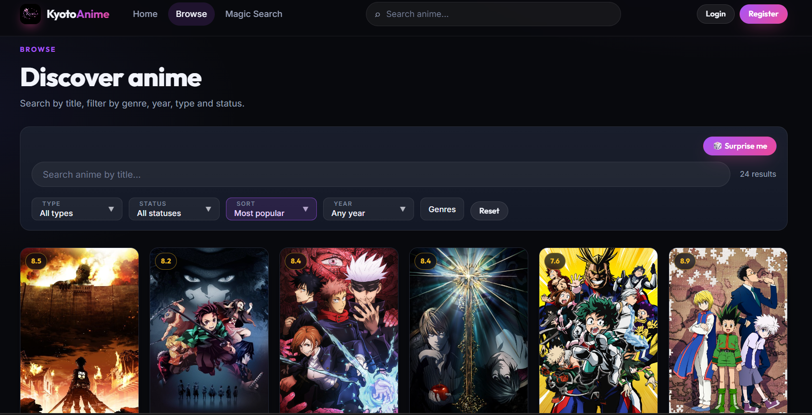
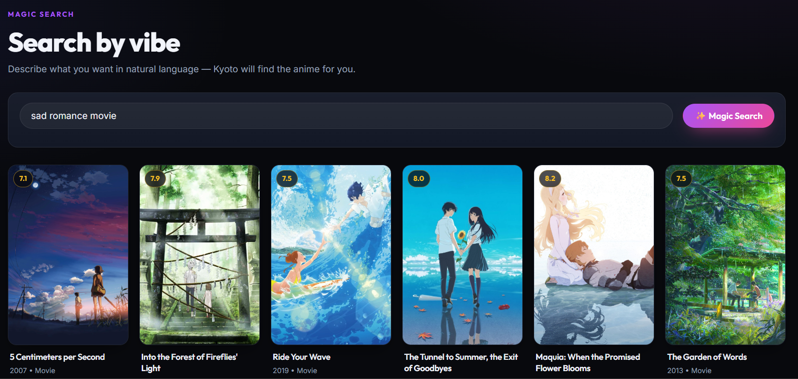
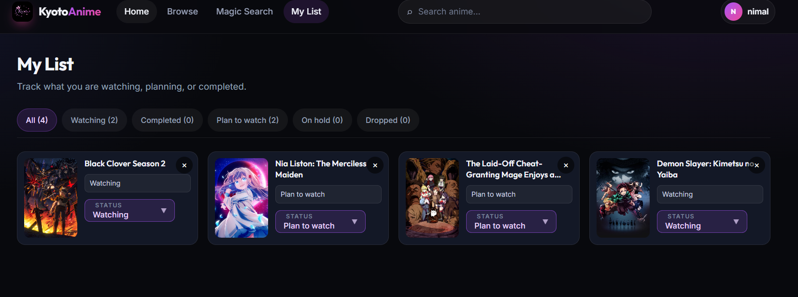
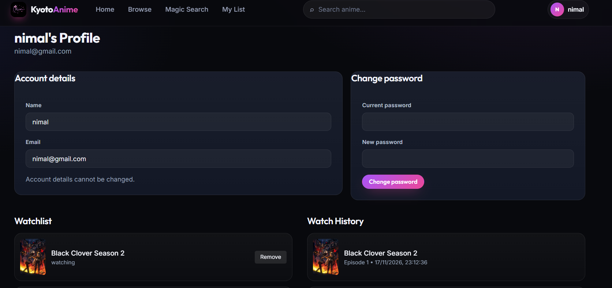
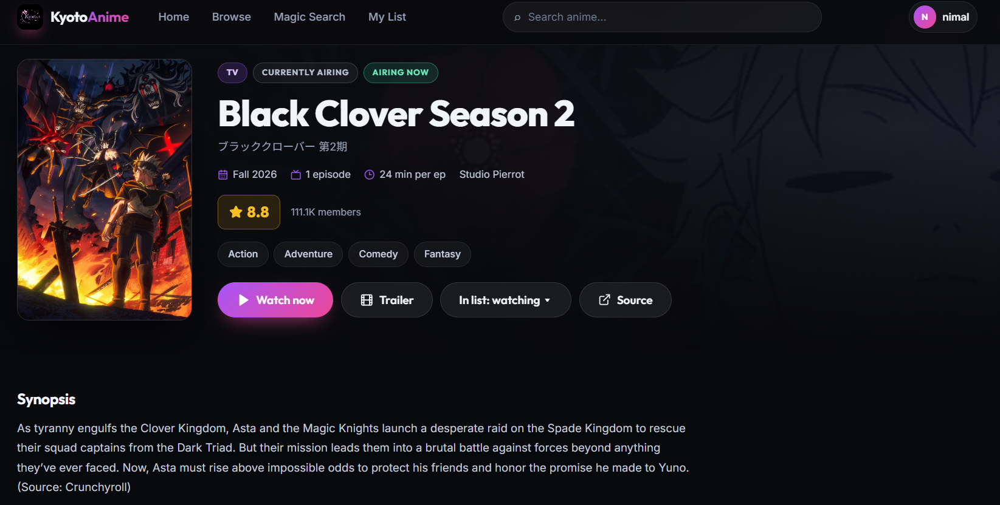
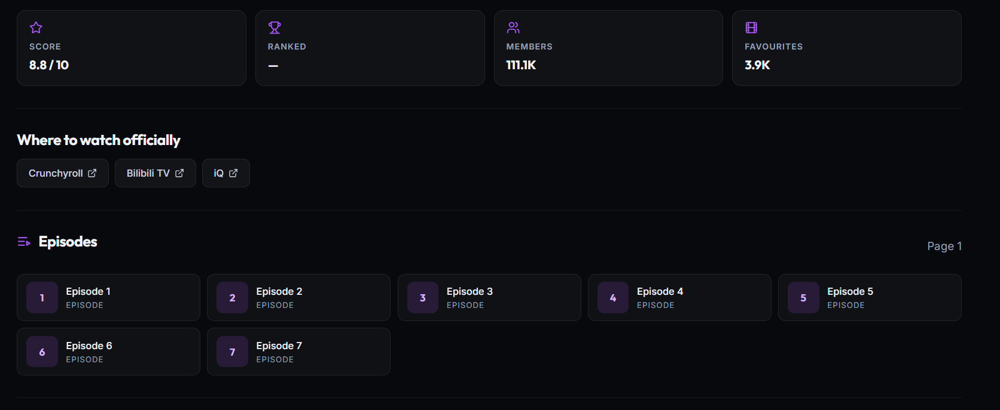
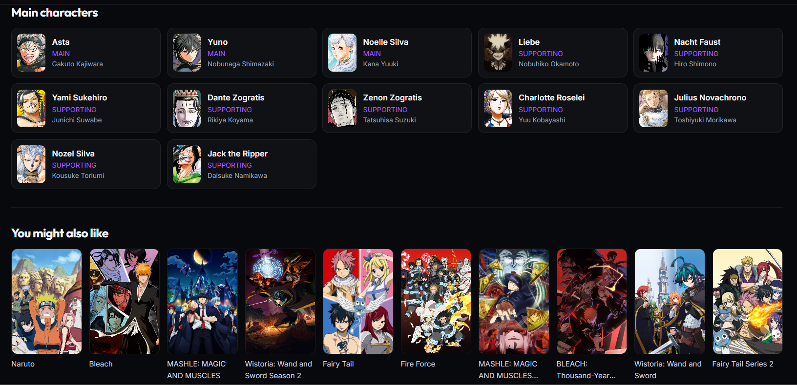

# Kyoto Anime - Full Stack Anime Discovery & Streaming Platform

Kyoto Anime is a full-stack web application that lets users discover, browse, track and watch anime. It combines AniList metadata with a cinematic React UI, custom Cloudinary HLS streaming for demo episodes, JWT-based authentication, personal watchlists, watch history, and reviews.

## Tech Stack

**Frontend**
- React 18 + TypeScript
- Vite
- Redux Toolkit (global state)
- TailwindCSS
- React Router v6
- Axios
- React Player & Custom HLS VideoJS Player
- Lucide icons

**Backend & Cloud**
- Node.js + Express + TypeScript
- MongoDB + Mongoose (via MongoDB Atlas)
- Cloudinary (Video hosting & HLS stream generation)
- JWT (access token) + httpOnly refresh cookie (rotation)
- bcryptjs (password hashing)
- Zod (input validation)
- Helmet, CORS, Morgan, express-rate-limit

## Features

- Browse & search anime by title, genre, year, season, type, status and rating
- Anime details: synopsis, episodes, characters, recommendations, trailers
- Custom HLS video player streaming demo episodes directly from Cloudinary, with intelligent YouTube iframe fallback
- Personal watchlist with statuses (watching, completed, plan to watch, on hold, dropped)
- Watch history with continue-watching progress tracking
- Reviews & ratings (1-10) separated per anime
- JWT authentication with refresh-token rotation and role-based authorization
- Responsive TailwindCSS UI with glassmorphism design

## Setup & Run

### Backend

```bash
cd "kyoto anime server"
npm install
cp .example.env .env   
npm run dev      

### Required environment variables

MONGODB_URI - MongoDB Atlas connection string
PORT - server port (default 5001)
JWT_SECRET - secret for signing access tokens
JWT_EXPIRES_IN - access token lifetime (e.g. 15m)
REFRESH_TOKEN_DAYS - refresh token lifetime in days
CLIENT_URL - frontend origin for CORS
ANILIST_API_URL - AniList GraphQL endpoint
YOUTUBE_API_KEY - (optional) YouTube Data API key

Frontend

cd "kyoto anime client"
npm install
npm run dev            # http://localhost:5173


Production build

Bash

# frontend
npm run build          # outputs to dist/

# backend
npm run build          # compiles to dist/
npm start              # runs dist/server.js


Deployed URLs
Frontend: https://kyoto-anime-client.vercel.app
Backend: https://kyoto-anime-server.onrender.com
Frontend Repository: https://github.com/AsiniKaru/kyoto-anime-client
Backend Repository: https://github.com/AsiniKaru/kyoto-anime-server


Project Structure
src/
  api/          # Axios client + endpoint helpers
  components/   # Reusable UI components
  context/      # Auth context (Redux-backed)
  hooks/        # Custom hooks
  pages/        # Route pages
  store/        # Redux store & slices
  types/        # TypeScript types
  utils/        # Formatters & helpers

Screenshots










License
Kyoto Anime - Rapid Application Development (RAD) final coursework by Asini Karunanayaka.